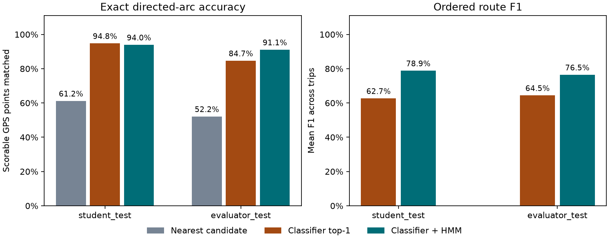
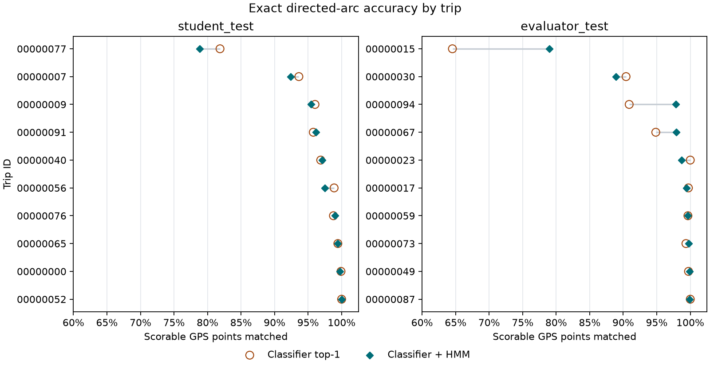

# PathSnap held-out test results

The same saved tuned logistic regression model ran on all 10 trips in each test partition. The evaluator trip IDs were disjoint from the recorded training and student-test trip IDs.

- **Student test.** Exact directed-arc accuracy was 94.83% for classifier top-1 and 93.97% after HMM decoding (11,541 of 12,281 scorable points). Mean ordered route F1 increased from 62.73% to 78.88%.
- **Evaluator test.** Exact directed-arc accuracy was 84.70% for classifier top-1 and 91.12% after HMM decoding (11,539 of 12,663 scorable points). Mean ordered route F1 increased from 64.46% to 76.49%. Trip `00000015` accounted for 1,040 of the 1,124 decoded mismatches. Trip `00000087` had the highest decoded accuracy at 99.90% (959 of 960).





[Partition summary and run metadata](summary.json) · [Per-trip metrics](per-trip.csv)

## Scoring

- **Exact directed-arc accuracy** counts exact arc ID matches on observations labeled `ok` by the project's monotone alignment against each reference route. Ambiguous and distant labels are excluded, and unmatched scorable observations count as errors. Partition accuracy pools scorable points. Mean trip accuracy gives each trip equal weight.
- **Ordered route F1** is twice the longest common subsequence length divided by the combined arc counts of the predicted and reference routes. The top-1 sequence collapses consecutive repeats within each uninterrupted GPS segment. The HMM sequence includes connecting arcs across observations and preserves repeat traversals. Partition F1 gives each trip equal weight.
- **Inference time** covers classifier probability scoring and HMM decoding. Each trip was measured once in the local Python process after candidate and graph construction.

## Reproduce

From the repository root, use the saved tuned model and the adjacent `metrics.json` from the [tuning run](../../README.md#tune-logistic-regression-with-bayesian-optimization). The two dataset roots below are the parent directories of `student_test` and `evaluator_test`, respectively.

```sh
OPENBLAS_NUM_THREADS=1 OMP_NUM_THREADS=1 MKL_NUM_THREADS=1 \
  uv run --locked --extra models python reports/test-evaluation/evaluate.py \
  --student-root "../Student folder" --evaluator-root .. \
  --model reports/model-tuning/logistic_regression_tuned.joblib
```

The script runs the PathSnap candidate generator and HMM decoder directly and opens each reference route after prediction. It writes the summary, CSV, and PNGs beside the script by default. Pass `--out` to write a separate run.
